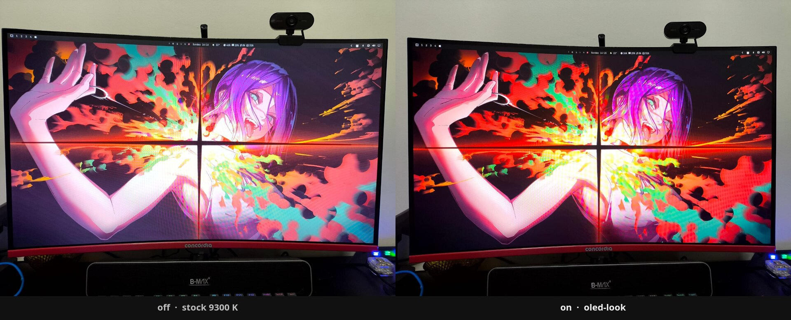
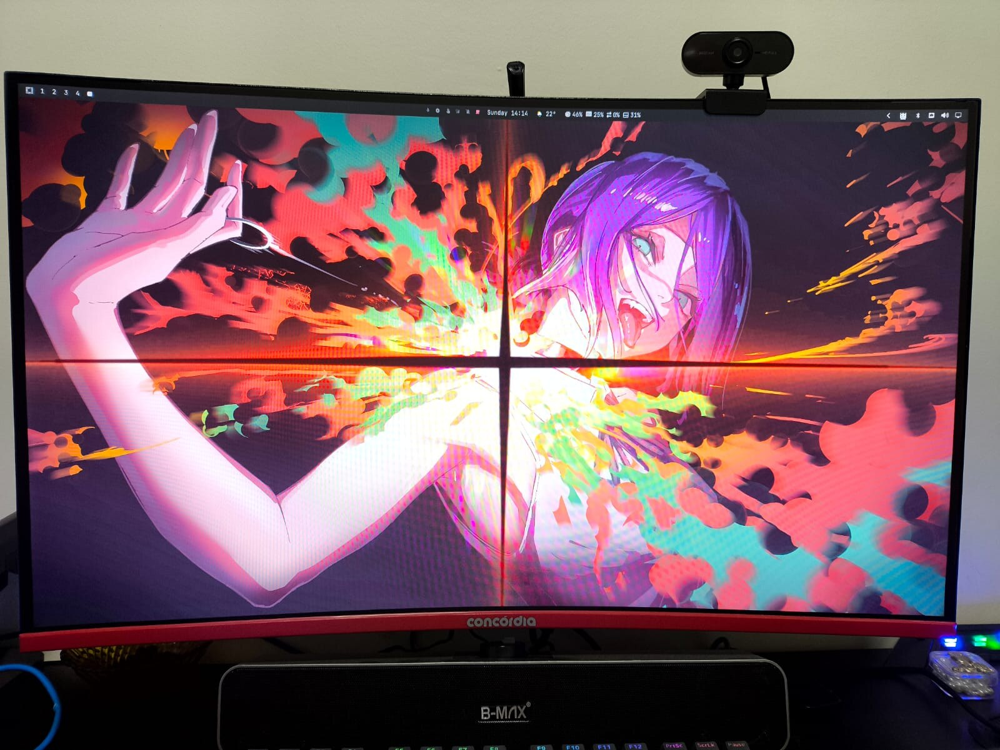
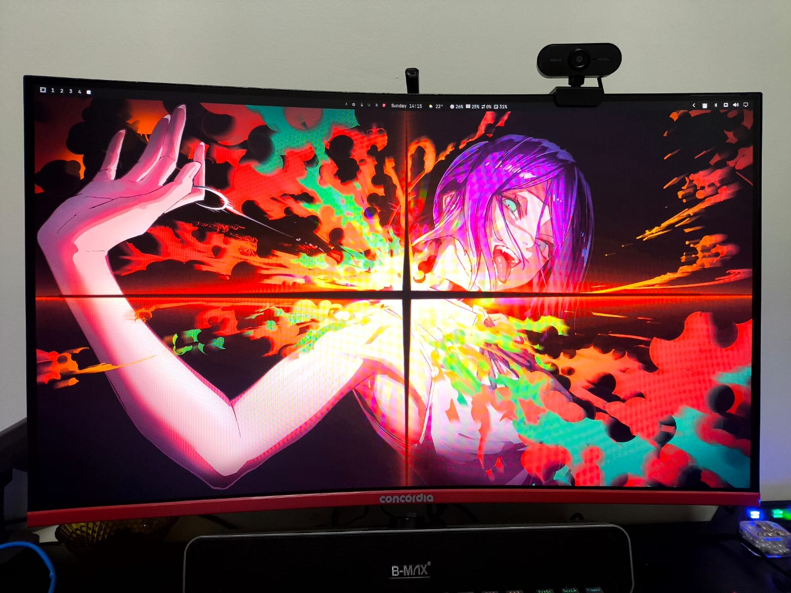

# oled-look

<p align="center">
  <strong>An OLED-like grade for LCD monitors on <a href="https://hypr.land">Hyprland</a>.</strong><br>
  6500&nbsp;K on the panel. Deeper blacks, punchier contrast, restrained vibrance in a screen shader.
</p>

<p align="center">
  
</p>

<p align="center">
  <a href="https://hypr.land"></a>
  <a href="https://omarchy.org"></a>
  <a href="LICENSE"></a>
</p>

Phone shots of a **VIE CZ270F100** (Mstar, HDMI, 1080p 100&nbsp;Hz). Left is stock **9300&nbsp;K**. Right is this profile.

It will not turn an LCD into an OLED. It gets the white point out of store-demo blue and gives the picture some depth.

```sh
oled-look.sh on     # 6500 K + shader
oled-look.sh off    # stock 9300 K, no shader
```

## Before / after

| off | on |
| :---: | :---: |
|  |  |

Same desk, same wallpaper, ~1 minute apart.

## What it does

Two layers, because this panel lies about DDC:

1. **Hardware** — `ddcutil` sets color preset **6500&nbsp;K** (D65). RGB actually moves. Contrast, saturation, and brightness VCP writes are advertised, then ignored.
2. **Compositor** — a Hyprland `screen_shader` applies a gentle S-curve, a little black crush, and vibrance that leaves already-saturated pixels alone.

A flag file turns the shader on. `oled-look.sh` also sets `decoration:screen_shader` via `hyprctl`, so a wiped `looknfeel.lua` still applies until the next compositor reload. An Omarchy `post-boot` hook puts 6500&nbsp;K and the shader back after login.

## Install

On Omarchy / Hyprland, with `ddcutil` installed and your user in the `video` group:

```sh
git clone https://github.com/Gedankenn/oled-look.git
cd oled-look

mkdir -p ~/.config/hypr/scripts ~/.config/hypr/shaders ~/.config/omarchy/hooks/post-boot.d

install -m 755 oled-look.sh ~/.config/hypr/scripts/oled-look.sh
install -m 644 shaders/oled-look.frag ~/.config/hypr/shaders/oled-look.frag
install -m 755 hooks/oled-look-hook.sh ~/.config/omarchy/hooks/post-boot.d/oled-look-hook.sh
```

Paste `snippets/looknfeel.lua` into `~/.config/hypr/looknfeel.lua`, then:

```sh
~/.config/hypr/scripts/oled-look.sh on
```

Other cheap Mstar HDMI panels often behave the same: temperature and RGB work, the rest is shader.

## Tune

Edit `~/.config/hypr/shaders/oled-look.frag` and reload (`oled-look.sh on` or `hyprctl reload`):

| Knob | Default | Effect |
| --- | --- | --- |
| `CONTRAST` | `0.32` | Mix toward an S-curve |
| `VIBRANCE` | `1.2` | Boost weak chroma, protect skin/sky |
| `BLACK_CRUSH` | `0.022` | Fake a lower black floor |
| `GAMMA` | `1.055` | Slightly darker midtones |

If the OSD still has Contrast / Color, those stack with the shader — DDC cannot set them on this monitor.

## Files

| Path | Role |
| --- | --- |
| `oled-look.sh` | Toggle: flag + DDC preset + `hyprctl reload` + shader keyword |
| `shaders/oled-look.frag` | Hyprland `decoration:screen_shader` |
| `snippets/looknfeel.lua` | Load the shader only when the flag exists (survives reload) |
| `hooks/oled-look-hook.sh` | Re-apply 6500&nbsp;K and the shader on Omarchy `post-boot` |
| `preview/` | Off / on photos and the comparison strip |

Flag: `~/.local/state/omarchy/oled-look`

## License

[MIT](LICENSE) © Fabio Slika Stella
